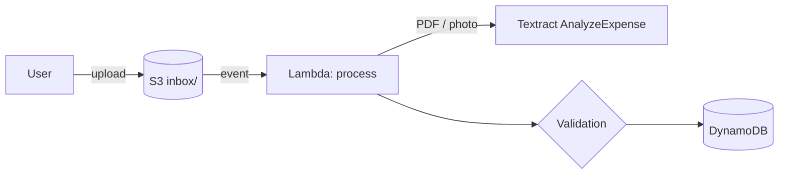

# LedgerLens

**Turn invoices and receipts into a validated expense ledger.** LedgerLens reads e-invoices (UBL XML), PDFs and photos, checks that the numbers make sense, and exports a ledger ready for accounting. It runs serverless on AWS, so you only pay per processed document.

> Status: works locally and fully tested; not deployed yet.

## The problem

Typing invoices by hand is slow, expensive and error-prone. Commercial tools solve it, but they are priced for large companies. LedgerLens is a small, open alternative built on managed AWS services.

## What it does

| Step | Detail |
| --- | --- |
| 1. Receive | A file is uploaded to S3 |
| 2. Read | **UBL XML** (Peppol and national e-invoicing) → exact and free · **PDF/photo** → Amazon Textract `AnalyzeExpense` |
| 3. Validate | Required fields, subtotal + tax = total, tax rate, dates, buyer tax ID, OCR confidence |
| 4. Decide | `APPROVED`, `NEEDS_REVIEW` (with the reason) or `REJECTED` |
| 5. Export | Excel or CSV ledger; documents that need review are highlighted |

## Architecture



More detail in [`docs/architecture.md`](docs/architecture.md).

## Project structure

```
ledgerlens/
├── src/ledgerlens/
│   ├── models.py           # Document, LineItem, Issue, Status
│   ├── normalize.py        # amounts, dates, currencies, tax IDs
│   ├── ubl_parser.py       # UBL 2.1 XML e-invoices
│   ├── textract_parser.py  # Textract AnalyzeExpense response -> Document
│   ├── extract.py          # picks XML or Textract per file
│   ├── validation.py       # business rules
│   ├── pipeline.py         # orchestration
│   ├── repository.py       # DynamoDB and in-memory storage
│   ├── export.py           # CSV and Excel
│   ├── cli.py              # local command line
│   └── handlers/           # AWS Lambda entry points
├── infra/template.yaml     # infrastructure as code (AWS SAM)
├── tests/                  # pytest suite
│   └── samples/            # FICTITIOUS documents
└── docs/
```

## Run it locally (no AWS needed)

Requires Python 3.11+.

```bash
python3 -m venv .venv && source .venv/bin/activate
pip install -e ".[dev]"
pytest
ledgerlens tests/samples/ --output ledger.xlsx
```

To read real PDFs or photos with Textract (needs AWS credentials):

```bash
pip install -e ".[aws]"
ledgerlens my_documents/ --textract
```

## Deploy to AWS

> Deploying creates billable resources. Set up an AWS Budgets alert first.

Requires the [AWS SAM CLI](https://docs.aws.amazon.com/serverless-application-model/latest/developerguide/install-sam-cli.html).

```bash
sam build -t infra/template.yaml
sam deploy --guided
```

Upload a document to `s3://<Bucket output>/inbox/` and check the DynamoDB table. Remove everything with `sam delete`.

## Roadmap

- [x] UBL XML and Textract readers
- [x] Validation rules and statuses
- [x] Excel and CSV export
- [ ] Country-specific rules (tax ID check digits, tax rates)
- [ ] Duplicate detection
- [ ] Least-privilege IAM and encrypted storage
- [ ] Continuous integration
- [ ] Review web app (Cognito + frontend)

## Tech stack

Python 3.12 · AWS Lambda · Amazon S3 · Amazon Textract · Amazon DynamoDB · AWS SAM

## License

MIT. Documents in `tests/samples/` are fictitious: tax IDs and company names are made up.
